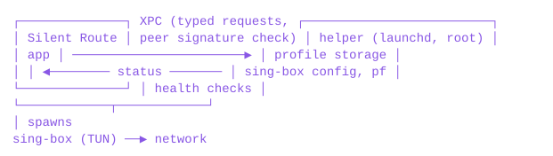

# Silent Route

Silent Route is a macOS client for [sing-box](https://github.com/SagerNet/sing-box). It lets you decide, per site, address, country, app and port, which tunnel or proxy each piece of traffic goes through, and backs that up with a kill switch enforced by pf, so nothing leaves the Mac by a path you didn't choose.

I wrote it because I needed several exits at once (some traffic direct, some through one server, some through another) and none of the existing clients handled that together with a kill switch I could trust.

Runs on Intel and Apple Silicon Macs, macOS 14 Sonoma through macOS 27 Golden Gate.

[Releases](../../releases)

**Status:** beta. The core and the helper pass an end-to-end test on a real Mac, but the UI is still moving and there will be rough edges. If the network ever ends up in a bad state, see [Recovery](#recovery).

## Features

- Profiles contain servers and routes. Supported servers: Hysteria2, VLESS (incl. Reality), Trojan, Shadowsocks, VMess, SOCKS5, HTTP, HTTPS. Servers can be added from a share link, by hand, or by pasting a proxy in the usual seller formats (`host:port:user:pass`, `user:pass@host:port`, `user:pass|host:port` and the like); link parameters that sing-box does not support are reported instead of ignored.
- A route matches traffic by domain, IP/CIDR, country (geoip), site list (geosite), app, port and protocol, and sends it direct, blocks it, or sends it through an ordered list of servers. The first server in the list that responds is used. Routes are evaluated top to bottom; the default route ("Everything else") is last.
- Each route has its own kill switch setting: when none of its servers respond, its traffic is either blocked or sent direct.
- Profiles can be switched from the menu bar while connected. If either profile uses a kill switch, traffic stays blocked until the new configuration is up.
- Profiles are exported and imported as `.srprofile` files (JSON). Note that they contain server credentials.
- Profiles belong to each macOS user: on a shared Mac every account has its own profiles, and nobody sees another's servers or passwords. The VPN itself is one for the whole Mac; while someone else's is on, you see only that it is on, and may turn it off.
- Advanced options, off by default, where they belong:
  - **Tunnel MTU** (profile › Network): the largest packet sent through the tunnel at once. Automatic suits almost every network; 1400 or 1280 helps where pages load halfway and hang. **Custom…** takes any value from 1280 to 9000.
  - **Multiplexing** (server › Advanced): many connections carried inside a few to the server — fewer handshakes, optional padding that blurs the traffic's shape. The server must have it enabled with the same protocol (h2mux, smux or yamux). Not for Hysteria2 (QUIC already multiplexes) or VLESS with XTLS Vision.
  - **TLS fragmentation** (route): splits the first packet of secure connections, where the site's name is visible, into pieces. Meant for routes that go direct.
- The Monitor page shows throughput, per-app traffic and the list of open connections with the route and server used by each.
- macOS notifications when a route fails over, falls back to direct, gets blocked or recovers. Optionally also when the VPN connects, disconnects or loses the connection.
- Settings › General › Transparency: *Standard* or *More* see-through menu bar panel.
- The interface follows Apple's Human Interface Guidelines for macOS: the VPN switch at the top of the sidebar, each page's view switch centred in the toolbar and its actions on the trailing side (Save and Revert too), plain grouped sections in the content (Liquid Glass stays with the controls), Settings as toolbar panes, and every toolbar action also in the menu bar — File › New Profile (⌘N), Import Profile… (⌘O), Export Profile… (⇧⌘E); View › Monitor, Logs, Active Profile (⌘1–3); VPN › Turn VPN On/Off (⇧⌘T), Emergency Restore…; Help › Silent Route Help.
- Session logs: each time the VPN is turned on, its session (connects, reconnects and why, failovers, sing-box warnings and errors) is logged into the home folder of the macOS user who turned it on: `~/Library/Logs/Silent Route`, readable only by that user, so it opens in Finder or Console. The last 30 sessions are kept. The app shows them under Logs, with a filter for problems and a way to copy or save a log with addresses and names removed. By default logs are left out of Time Machine backups and Spotlight search; both can be allowed in Settings › Advanced.
- Short network drops (a Wi-Fi switch, waking from sleep) don't restart sing-box: the helper checks the servers every 2 seconds and restarts only after 12 seconds without an answer, so calls and downloads often survive the drop. Traffic stays blocked meanwhile where the kill switch is on.
- No DNS leaks through the router: while the VPN is on, macOS's resolver points into the tunnel and sing-box answers by your profile's rules; the kill switch lets only sing-box ask the router. Local names (`nas.lan`, zones you choose) still go to the router. Nothing is changed in your saved network settings.
- Hotel and café Wi-Fi: when a network wants a login, the VPN stays on behind its kill switch and offers **Open Login Page** — a small window whose traffic alone goes out directly. After you log in, the VPN carries on through the same server, with the same address.
- The VPN is never started automatically, including after a reboot. Quitting the app turns the VPN off by default; this can be changed in Settings. Connection time and traffic are counted per connection by default, or across reconnects from the moment the VPN was turned on.

### A word of caution about server lists

A route with several servers fails over on its own, which is convenient, but your IP address changes in the middle of a session when it does. Banks, payment systems, marketplaces, AI services and anything else with serious anti-fraud checks see this as a session jumping between countries or providers, and may log you out, ask for verification or flag the account. For those services, give the route a single server and turn its kill switch on. Lost connectivity is better than a sudden change of address.

## Installation

1. Download `Silent-Route-<version>.dmg` from [Releases](../../releases).
2. Open the image and copy Silent Route to Applications.
3. The app is not notarized (there is no Apple Developer account behind it), so Gatekeeper blocks the first launch. Remove the quarantine attribute in Terminal:

   ```sh
   xattr -dr com.apple.quarantine "/Applications/Silent Route.app"
   ```

   Alternatively, try to open the app once, then go to System Settings → Privacy & Security and click Open Anyway.
4. Launch the app and click Install Helper. macOS asks for an administrator password: the helper is a launchd daemon running as root that manages sing-box and pf.

### Updating

Settings → Updates (or Silent Route → Check for Updates…) downloads the new release, verifies its SHA-256 and code signature, replaces the app and relaunches it. Replacing the app manually with a newer DMG works as well; in that case remove the quarantine attribute again.

The helper is updated from the new version right away, before the relaunch: macOS asks for the administrator password when you click Install. A small window shows the progress. Profiles are stored by the helper in `/Library/Application Support/Silent Route` and are not affected; the installer also keeps the last ten copies in `backups/`.

- **VPN on, with a kill switch:** traffic outside the tunnel stays blocked the whole time one helper replaces the other, and the new helper brings the VPN back by itself, through the same profile. Until then, **Cancel** in the update window turns the VPN off and the network goes back to normal (you are warned that traffic is then no longer protected).
- **VPN off:** the network is not touched at all.
- **If the new helper does not start**, the previous one is put back and carries on. If neither starts, nothing is lifted on its own: the update window offers **Restore Network** (the VPN turns off, nothing stays blocked; administrator password), and a restart of the Mac clears it too. By hand: `sudo "/Library/Application Support/Silent Route/uninstall.sh" restore-network`.

### Uninstalling

- Settings → Uninstall Silent Route…, or
- `/Library/Application Support/Silent Route/Uninstall Silent Route.command`, or
- an app cleaner such as AppCleaner. The helper detects that its files are gone, restores the network and unregisters itself.

All three remove the helper, profiles, the `_silentroute` group and the `sroute` symlink. Session logs, which live in each user's home, are removed for every user of the Mac unless you choose to keep them (the app and the `.command` file ask; an app cleaner removes them).

### Recovery

Emergency Restore (menu bar or ⇧⌘⌫) stops the VPN, removes the pf rules and repairs the default route. The same from Terminal: `sroute panic`. Nothing Silent Route sets up survives a reboot.

## Design

<p align="center"></p>

- The helper owns all state. The app sends typed requests over XPC; the helper builds the sing-box configuration and pf rules itself and never accepts a raw config. XPC clients must be signed with the same certificate as the helper. macOS tells the helper which user each request comes from: profiles are kept per user (`/Library/Application Support/Silent Route/users/<uid>/`, root only), and a request sees only its own user's.
- Session logs are written by the helper (root) into a folder the user owns, so it never opens anything there by a path the user could swap: each folder on the way is opened without following symbolic links and must belong to the user, the file is always created new, and writes go through the descriptors opened then. The files belong to the user, mode 0600.
- The helper copies its binaries and sing-box into root-owned directories and checks sing-box's SHA-256 against `singbox.pin` before each launch.
- Kill switch: sing-box runs with the `_silentroute` group as its effective gid, and the pf anchor `com.apple/silentroute` only passes traffic from that group on physical interfaces (plus loopback, DHCP and, optionally, the LAN). pf therefore needs no knowledge of routing: anything not sent by sing-box is dropped. Silent Route does not modify the main pf ruleset or other anchors.
- Failover: every 10 seconds the helper measures each server in use through the sing-box clash API and selects, for every route, the first server that responds. If sing-box exits, the pf rules stay loaded and the helper reconnects with backoff.
- geoip/geosite rule-sets are not bundled. sing-box downloads the ones a profile references from the SagerNet rule-set repositories, caches them and refreshes them weekly.

Design notes and test results are in [docs/decisions.md](docs/decisions.md).

### Network access

Every connection Silent Route makes or lets through — by whom, where to, by which path and when, how DNS is resolved, what the kill switch lets out, and how a hotel or café Wi-Fi login works — is described in **[docs/network.md](docs/network.md)**. In short: apart from the traffic you route, only server health checks, address-list downloads, the Wi-Fi login check and update checks go out; there is no telemetry.

## Command line

The helper installs `/usr/local/bin/sroute`:

```
sroute status | up | down | panic
sroute profiles | use <profile> | import <file> | export <profile> <file> | delete <profile>
sroute servers | routes | add <link> | remove <name>
sroute probe <link>    test a server through a temporary local proxy
sroute diag            interfaces, routes, other active VPNs
```

## Building

Requires Swift 6 and the macOS 26 SDK (Xcode 26 or the matching Command Line Tools).

```sh
scripts/build-app.sh      # build/Silent Route.app, universal, signed with a local self-signed identity
scripts/test.sh           # unit tests; generated configs are also checked with `sing-box check`
swift run ui-snapshots    # renders views to PNG for review
sudo experiments/integration/run.sh   # end-to-end test on a real Mac (turns off networking briefly)
```

Releases are built by GitHub Actions when a `v*` tag is pushed (`.github/workflows/release.yml`).

| Directory | Contents |
|---|---|
| `Sources/VPNCore` | model, link parser, sing-box and pf generators (no I/O) |
| `Sources/VPNHelperKit` | helper state machine, pfctl / sing-box / network adapters |
| `Sources/SilentRouteHelper` | helper executable |
| `Sources/SilentRouteUI`, `Sources/SilentRouteApp` | app |
| `Sources/sroute` | CLI |
| `Resources/install-helper.sh` | install, update, uninstall |

## Legal

VPN software is restricted or regulated in some countries. Make sure that using it is legal where you live; complying with local law is your responsibility. The software is provided as is, without warranty (see the license).

## License

GPL-3.0, see [LICENSE](LICENSE).

Release builds include an unmodified sing-box binary (GPL-3.0-or-later, © nekohasekai); its source code is attached to each release. Silent Route is not affiliated with the sing-box project.
